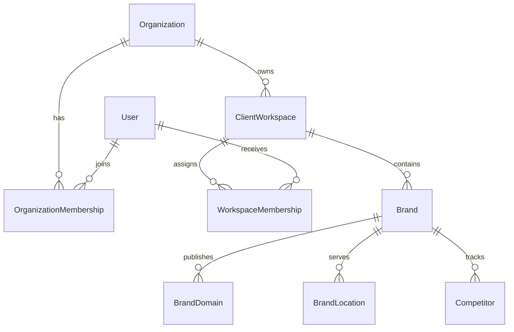
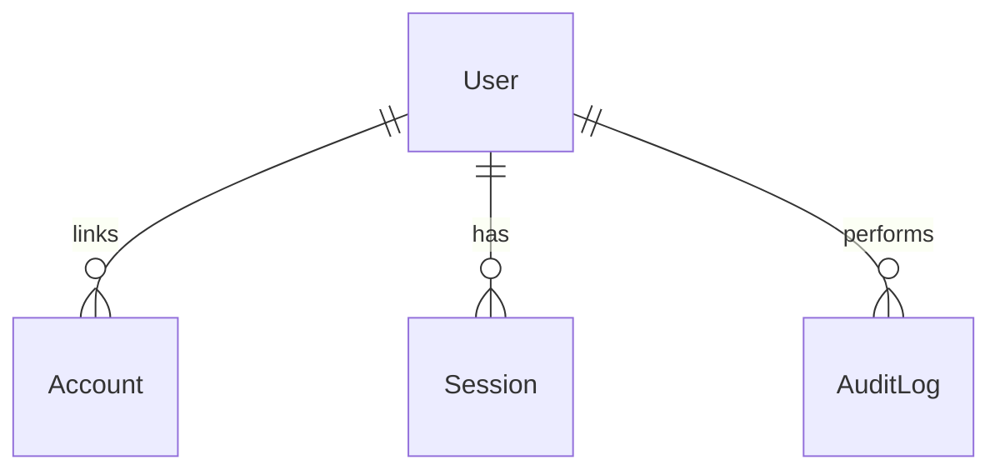
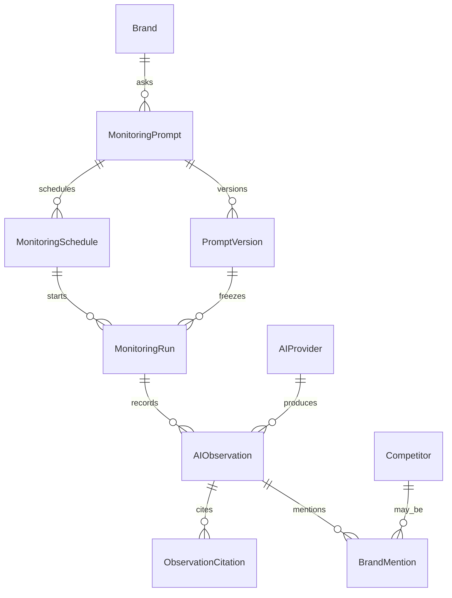
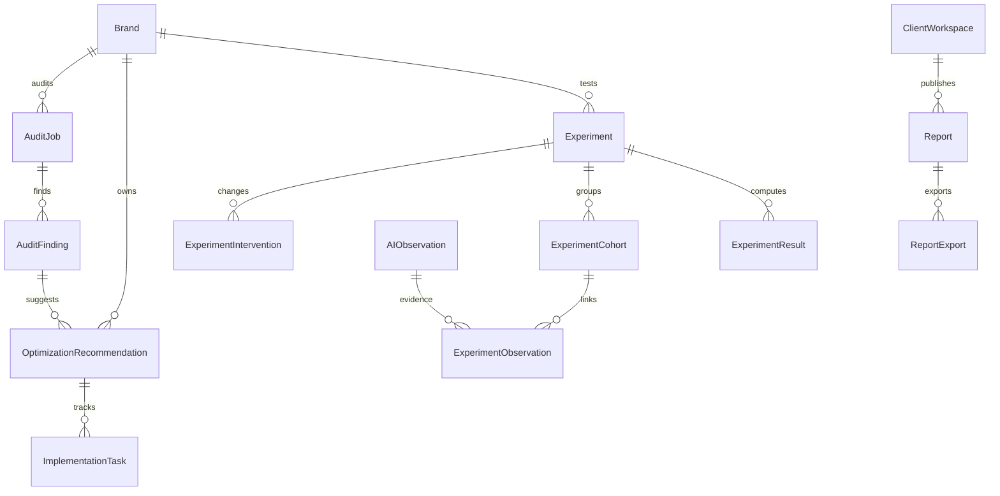
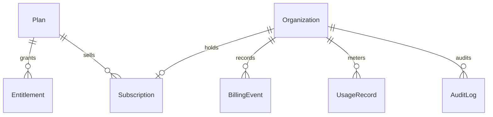

# Database ERD

The source of truth is `packages/db/prisma/schema.prisma`. Table names are snake_case. Identifiers for domain rows are UUIDs. Auth.js `accounts` and `sessions` primary keys are text because Auth.js may supply its own ids. `users.id` is a UUID generated by the database; the Prisma adapter strips any inbound user id.

Timestamps are `timestamptz`. Evidence tables omit `updated_at`.

## Tenant boundary

`Brand.workspace` references `(organization_id, workspace_id)`. A brand cannot be attached to a workspace from another organization. The same pattern is used for prompts, runs, observations, audits, recommendations, experiments, and reports where the parent link is required.

`Organization.kind` is `AGENCY` or `BUSINESS`. Creating an organization also creates a default workspace with the same slug. That keeps every brand path inside a workspace.

## Identity

`User.platform_role` is `NONE` or `PLATFORM_ADMIN`. Organization roles live only on `organization_memberships`: `OWNER`, `ADMIN`, `MEMBER`, `CLIENT_VIEWER`.

Passwords are stored as scrypt hashes in `users.password_hash`. Sessions in M01 are JWTs, and the `sessions` table remains so the Auth.js adapter can use database sessions later.

## Monitoring evidence

`PromptVersion` is immutable. `MonitoringPrompt.current_version_id` is a pointer without a foreign key, so moving the pointer does not rewrite history.

`AIObservation` stores provider id, surface (`MODEL_API`, `GROUNDED_SEARCH`, `CONSUMER_SEARCH`), engine id, locale, market, execution time, prompt version, status, token counts, decimal cost with currency, and a storage reference plus SHA-256 for the raw payload. Deleting a run or a prompt version is restricted while observations exist.

`provider_secret_refs` points at an external secret name. It is not shown as a child of observations.

A partial unique index in the initial migration allows only one primary domain per brand. A check constraint rejects a brand mention that sets both `brand_id` and `competitor_id`.

## Audits, experiments, reports

`ExperimentObservation` links a cohort to an existing observation. Results are append-only. Recomputing inserts a new `experiment_results` row.

## Billing

`plans.amount_minor` is an integer. `usage_records.quantity` is a decimal. Subscription status and Stripe ids are references, not secrets. No plan is activated by M01.

## Deletion

| Child | Parent delete |
| --- | --- |
| Accounts, sessions, organization memberships | Cascade |
| Workspaces, brands, observations, findings, experiment rows, reports, billing rows, audit logs | Restrict |
| Optional schedule location, run schedule, recommendation finding | Set null |

An organization that still has a workspace cannot be deleted. A workspace that still has a brand cannot be deleted through the brand relation. Evidence is not removed by a parent delete.
